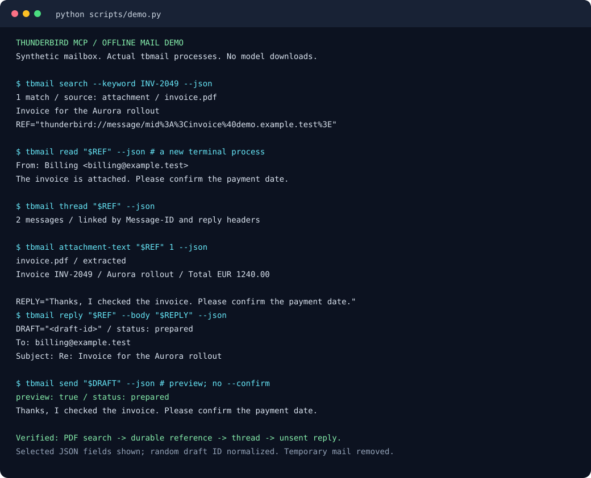

# thunderbird-mcp

**Read, search, organize, and send Thunderbird mail from your AI tools.**

[](https://github.com/jamessi1989/thunderbirdmcp/actions/workflows/checks.yml)
[Demo](docs/demo.md) · [Installation guide](docs/installation.md) ·
[Releases](https://github.com/jamessi1989/thunderbirdmcp/releases) ·
[Report your installation](https://github.com/jamessi1989/thunderbirdmcp/issues/new?template=installation-feedback.yml)

Work with your mail from Claude Code, Codex, OpenCode, Terminalman, or a normal
shell. The MCP exposes 23 tools across these workflows:

| Workflow | Available now |
| --- | --- |
| Read and find | Read messages and threads; search downloaded mail by keywords or meaning; search fresh mail over IMAP; find text inside PDF and Office attachments. |
| Compose and send | Prepare new messages with To/Cc/Bcc and attachments; draft replies and reply-all; review and send saved drafts with duplicate-send protection. |
| Organize | List and create IMAP folders, preview and execute bulk moves of indexed messages, and undo recorded move batches. |
| Reference and export | Reuse mail references across projects and sessions; export original messages and individual attachments. |
| Accounts and diagnostics | Select accounts per operation, check connection/index health, and refresh the local search index. |

Sending uses SMTP and credentials kept in the system keyring. The demo below
shows one workflow: finding a PDF invoice, reusing its reference, and preparing
an unsent reply.



## Start using it

You need Python 3.10+ and [uv](https://docs.astral.sh/uv/getting-started/installation/).
Clone the project and try the demo before connecting your mailbox:

```bash
git clone https://github.com/jamessi1989/thunderbirdmcp.git ~/projects/thunderbirdmcp
cd ~/projects/thunderbirdmcp
uv sync --locked
uv run python scripts/demo.py
```

The demo uses temporary synthetic mail and an invoice PDF. It prepares an unsent
reply; it needs no mail credentials or AI model. To use your own mailbox,
configure Thunderbird to download messages in mbox format, then run:

```bash
uv run thunderbird-mcp-index
uv run thunderbird-mcp-setup --apply
```

The [installation guide](docs/installation.md) covers credentials, custom profiles,
installing a release wheel without a checkout, and troubleshooting. Linux is the
primary tested desktop; Linux and macOS run the synthetic suite and package
installation checks in CI. Native Windows installation is not yet verified.

Setup installs `tbmail`, `thunderbird-mail`, `thunderbird-mcp`, and
`thunderbird-mcp-setup` in `~/.local/bin`. It registers the MCP in the global
configuration of installed Claude Code, Codex, OpenCode, Antigravity, and Gemini
CLI clients.
Use `--clients claude codex` to select clients, or `--clients none` to install
only commands. Run setup without `--apply` to inspect changes. Existing settings
are preserved and changed files receive private timestamped backups. Repeating
setup is safe. MCP launchers use absolute paths and preserve your current directory.

Existing Terminalman sessions can load the tools using the
[client reload steps below](#reload-an-existing-session). The Terminalman server
does not need a restart. `tbmail` is immediately available through the shell,
including from an already running agent.

Setup uses these default client configuration files:

| Client (`--clients` name) | Global configuration |
| --- | --- |
| Claude Code (`claude`) | `~/.claude.json` |
| Codex (`codex`) | `~/.codex/config.toml` |
| OpenCode, including GLM (`opencode`) | `~/.config/opencode/opencode.jsonc` if present, otherwise `opencode.json` in the same directory |
| Antigravity (`agy`) | `~/.gemini/config/mcp_config.json` |
| Gemini CLI (`gemini`) | `~/.gemini/settings.json` |

Setup respects `CLAUDE_CONFIG_DIR`, `CODEX_HOME`, and `XDG_CONFIG_HOME` for their
respective clients. OpenCode uses the same MCP registration for all models;
no separate GLM server configuration is needed.

You can then ask:

- “Search my mail for the cloud-provider invoice from May.”
- “Check live IMAP for new unread mail in INBOX.”
- “Find the agreement mentioned inside an attachment and read that attachment.”
- “Read that conversation and give me a reference I can use in another session.”
- “Prepare a reply to this mail saying the migration is complete.”
- “Send draft `<draft-id>`.”
- “List my folders and preview moving those messages into Archive.”
- “Undo that move batch.”
- “Export that message and its PDF attachment to this project.”

## Check Codex, Claude, and OpenCode

Check the real mailbox and each client's registration:

```bash
tbmail status --network
codex mcp get thunderbird
claude mcp get thunderbird
opencode mcp list
```

After connecting or reloading, ask: “Use the thunderbird MCP to search my mail for
invoices, read the most relevant result, and give me its stable reference.”
Codex and Claude also show active MCP connections with `/mcp`. OpenCode's MCP
status is available through **Toggle MCPs** in the command palette.

### Reload an existing session

After updating the checkout and running `uv sync --locked` and
`uv run thunderbird-mcp-setup --apply`, refresh each running client's connection:

| Client | Reload without losing the conversation |
| --- | --- |
| Claude Code | Run `/mcp`, select `thunderbird`, and choose **Reconnect**. Open `/mcp` again to check that it is connected and lists **23 tools**. |
| OpenCode | Press **Ctrl+P**, choose **Toggle MCPs**, select `thunderbird`, then press **Space** to disable it and **Space** again to enable it. Check that it shows **connected**. |
| Codex | An existing app-server connection can reload its loaded threads using the protocol below. For a CLI session without that connection, wait until idle, use `/exit`, then run `codex resume --last` from the same project and check `/mcp`. |

Claude and OpenCode reconnects and Codex app-server reloads were verified in
running Terminalman sessions on 2026-11-02; the conversations were preserved.

<details>
<summary>Codex app-server integration: reload active threads</summary>

Verified with Codex CLI 0.166.0. A host connected to the existing app-server can
send these requests after the `initialize` / `initialized` handshake. The
verified connection enabled `capabilities.experimentalApi` during initialization.
Use the server that owns the active thread; a separate server has separate
connections.

```jsonl
{"id":1,"method":"config/mcpServer/reload","params":null}
{"id":2,"method":"mcpServerStatus/list","params":{"threadId":"<active-thread-id>","serverName":"thunderbird","detail":"toolsAndAuthOnly"}}
```

Reload reads configuration from disk and queues a refresh for loaded threads.
Check the status response again after the refresh completes; the `thunderbird`
tool inventory should contain 23 tools. The
[Codex app-server protocol](https://learn.chatgpt.com/docs/app-server) documents
the connection transport, handshake, reload request, and status query.
The [Codex CLI reference](https://learn.chatgpt.com/docs/developer-commands?surface=cli)
documents `/mcp` and conversation resumption.

</details>

### Test actual client tool calls

An opt-in test checks actual model tool calls in all three clients:

```bash
uv run python scripts/test_clients.py
```

It creates a temporary synthetic mailbox and exposes only `search_email`,
`get_email`, and `get_email_reference`. A client passes only after successful
tool calls return a hidden verification code and the correct reference. The
test uses your configured model accounts and may consume model credits. It
does not read your real mail or send anything. To select one client/model:

```bash
uv run python scripts/test_clients.py --clients opencode --opencode-model provider/model
```

Use `--report-dir /tmp/mail-client-check` to retain private troubleshooting logs.
Client flags can change between releases; this script is an opt-in integration
check, separate from the offline unit tests.

## Terminal commands

```bash
tbmail status --network                 # Verify TLS/login; sends no mail
tbmail accounts                         # Account IDs and identities; no credentials
tbmail search 'from:alex storage' --limit 5
tbmail search 'folder:INBOX after:2026-11-01' --keyword
tbmail search --live --unread --limit 5  # Fresh IMAP mail, default INBOX
tbmail search 'folder:Archive receipt' --live --account account2
tbmail search 'has:attachment agreement' --keyword
tbmail search --attachment report.pdf --account account2
tbmail read 12345
tbmail thread 12345 --bodies
tbmail reference 12345                  # Markdown citation with a durable URI
tbmail attachments 12345
tbmail attachment-text 12345 1          # Read document text without exporting
tbmail export 12345 ./message.eml
tbmail export-attachment 12345 1 ./attachment.pdf
tbmail reindex                         # Refresh downloaded mail
tbmail --json search 'invoice'          # Structured output for scripts/agents
tbmail folders --account account2       # Folders in the local index
tbmail folders --live --account account2
```

Pass a returned `thunderbird://message/...` reference in place of a numeric ID
to read, thread, reference, reply, attachment, and export commands. Stable
references use Message-ID, with a content hash fallback, and survive reindexing
and folder changes. Integer IDs also stay stable during ordinary refreshes, but
use the URI for references saved in another project or conversation. Paste it
into another Terminalman conversation and ask the agent to read it with the
thunderbird MCP. The search web app has a **Copy mail reference** button.

Live searches return `thunderbird://imap/...` references. The same read, thread,
reference, reply, attachment, and export commands accept them without a local
index. These references bind the account endpoint, folder, UIDVALIDITY and UID.
They expire when the message moves or the folder/account is replaced; a new
live search is then required. Use a local message reference for citations that
must survive folder moves.

For rare messages without Message-ID, the fallback hashes the indexed headers
and text. Messages with identical indexed text but different attachments can
share that fallback reference. A numeric ID selects the indexed row, but source
recovery after mailbox compaction can still be ambiguous. Use Thunderbird to
inspect the original copies in that case.

```bash
tbmail draft --to colleague@example.org --subject 'Migration update' \
  --body-file ./reply.txt --attach ./report.pdf
tbmail draft --account account2 --to colleague@example.org --subject 'Update' --body 'Ready.'
tbmail reply 'thunderbird://message/...' --body 'Thanks, I will check.'
tbmail drafts
tbmail drafts <draft-id>
tbmail send <draft-id>                  # Show the saved preview
tbmail send <draft-id> --confirm        # Submit exactly that saved draft
```

Drafts support To/Cc/Bcc and captured local attachments. Reply drafts preserve
In-Reply-To and References, honor Reply-To, and exclude your address from reply-all.
Drafts are local to this application; they do not appear in Thunderbird Drafts.
`--body-file -` reads standard input. Use `tbmail --help` for all commands.
Replies infer the original account when it can be identified; use `--account`
to select it explicitly. Each saved draft retains its original account and
sender even if you later change Thunderbird's default account.

## Sending and retry behavior

Each draft stores its exact MIME message, envelope, and account settings in a
private outbox database. Delivery atomically claims that draft. Concurrent or
repeated sends cannot submit it again. SMTP acceptance is recorded before the
Sent copy is saved, so failure to save the copy never causes another delivery.

Results distinguish `prepared`, `sending`, `sent`, `partially_sent`, `failed`,
and `uncertain`. An interrupted or uncertain send needs a delivery check; do not
create another draft automatically. `send_draft(retry_failed=True)` permits a
retry only after a known failure before delivery. Direct `send_email` defaults
to a preview and accepts an `idempotency_key` for programmatic retries. Prefer
the saved-draft workflow. Sending tests use a mocked SMTP server; live diagnostics
authenticate and issue NOOP without sending anything.

## MCP interface

The server exposes **23 tools, 3 resource URI patterns, and 2 prompts**.

| Workflow | Tools |
| --- | --- |
| Health and search | `mail_status`, `list_accounts`, `search_email`, `search_live_email`, `list_folders`, `reindex` |
| Read and cite | `get_email`, `get_thread`, `get_email_reference` |
| Original mail and attachments | `list_attachments`, `get_attachment_text`, `export_email`, `export_attachment` |
| Prepare and send | `draft_email`, `draft_reply`, `get_draft`, `list_drafts`, `send_draft`, `send_email` |
| Organize | `imap_list_folders`, `create_folder`, `move_emails`, `undo_move` |

Resources: `thunderbird://status`, `thunderbird://message/{key}`, and
`thunderbird://imap/{account}/{fingerprint}/{folder}/{uidvalidity}/{uid}`.
Prompts: `find_mail(query)` and `reply_to_mail(reference, instructions)`.
Tools have read/write annotations. Mail and attachment content is treated as
untrusted data. The server uses stdio; protocol stdout contains only MCP messages.

The current interface has no dedicated tools for forwarding, changing read/unread
or flagged status, permanent deletion, scheduled sending, contacts, calendars,
or Thunderbird message filters. Folder moves and their undo operations act on
indexed messages; live-only references cannot be passed directly to `move_emails`.

## Search and indexing

Local search combines FTS5 keywords, common-word typo correction, multilingual
local embeddings, recency, and optional conversation deduplication. Filters
include `from:`, `to:`, `folder:`, `after:YYYY-MM-DD`, `before:YYYY-MM-DD`,
`has:attachment`, and `attachment:filename`; `before:` is exclusive.
The separate `since`/`until` parameters accept dates, with `until` including that
whole day. Empty search lists recent mail. `semantic=False`/`--keyword` uses only
keywords; search diagnostics explain when semantic search is unavailable.
The initial `thunderbird-mcp-index` command builds the keyword index. Run the
embedding command separately to enable semantic retrieval; its first run may
download the embedding model.

```bash
uv run thunderbird-mcp-embed            # Incremental semantic vectors
uv run thunderbird-mail-web            # Default: http://127.0.0.1:3458
```

The local index reads Thunderbird's **downloaded mbox mail**. Thunderbird must
sync new messages and folders before local search can find them. Refreshing
this index does not fetch mail from IMAP. Local exports need the local original;
live references fetch their original from IMAP. Reads do not change read/unread
flags. Bodies are indexed up to 50,000 characters, with truncation reported.
Export original `.eml` files for complete local content. Exports do not overwrite
existing files or write inside Thunderbird mail storage.

`search_live_email` / `tbmail search --live` searches one server folder, default
INBOX. Words and quoted phrases use IMAP text matching and combine with AND;
header/date filters and `--unread`/`--read` are supported. Live dates require
`YYYY-MM-DD` and use the message header's calendar day; timestamps are rejected.
Results are headers, ordered by newest UID, and report omitted matches.
Live threads follow reply headers within that folder, bounded to 100 candidates
and 40 searches. Each live message and the combined raw MIME downloaded for a
thread, including attachments, are capped at 25 MiB. Live search does not provide
semantic ranking or extracted document text search; those use the local index.

Attachment text search supports TXT/CSV/JSON and other text formats, HTML/XML,
PDF, DOCX, XLSX, and PPTX. Filenames remain searchable when text extraction is
unsupported. `get_attachment_text` / `tbmail attachment-text` reads a selected
attachment, including from live mail. Extraction reports `extracted`, `empty`,
`unsupported`, `encrypted`, `too_large`, or `error`, plus truncation. Indexing
also reports `too_many` when the attachment-count limit is exceeded.
Scanned PDFs need OCR, which is not included.

Extraction limits are 8 MiB and 25,000 text characters per attachment. Indexing
also caps each message at 24 MiB decoded bytes, 64 attachments, and 100,000 text
characters. `get_attachment_text` extracts only the requested attachment.
Office archives are limited to 16 MiB expanded and 2,048 entries.
PDFs are limited to 50 pages and a ten-second child process; POSIX systems also
apply a CPU limit, and Linux caps process address space at 512 MiB. Macros and
external links are never executed by extraction. No document content is uploaded
for indexing. Mail text returned to a hosted AI client is sent to that client's
model provider.

Schema upgrades retain existing messages. Refreshes preserve IDs, skip expunged
messages, and commit each folder atomically; if Thunderbird changes a folder
during parsing, its previous index is kept for the next refresh. Threads use
Message-ID/References/In-Reply-To relationships rather than merging unrelated
messages with the same subject.

Upgrading to v0.3 rebuilds the derived FTS index once and reparses existing
folders to extract attachment text. Run `tbmail reindex --embeddings` after
`uv sync --locked`, or let the installed indexing service finish the backfill.
`tbmail status` reports pending extraction and format statuses. Existing mail
references remain valid.
Large full refreshes or embedding rebuilds can exceed an AI client's MCP tool
timeout; run those through `tbmail reindex --embeddings` or the background
service. Ordinary local searches remain available while backfilling.

Systemd units in `systemd/` refresh the index and embeddings ten minutes after
each completed run and run the existing authenticated web app. The web app loads
no external page assets and renders mail as plain text. It has keyboard navigation
(`/`, `j`, `k`, `o`) and optional cross-encoder reranking. Web credentials use the
`thunderbird-mail-web` keyring service. The supplied service binds to loopback.
To use a private network address, set `MAIL_WEB_HOST` in a local systemd override.
Adjust `WorkingDirectory` if the checkout is outside `~/projects/thunderbirdmcp`.

## Configuration

Thunderbird's selected profile and default account supply hostnames, ports,
identity, TLS mode, and Sent folder. Passwords stay in the system keyring:

```bash
tbmail accounts
tbmail password-set --account account1 --protocol imap
tbmail password-set --account account1 --protocol smtp
```

Passwords are entered through a hidden prompt, or one line through stdin with
`--stdin`. Each stored credential is scoped to account, host, port, username,
and protocol. The previous `thunderbird-mcp` username keyring entry still works
for an unambiguous default account. Secondary accounts use scoped credentials.
No passwords or OAuth tokens are placed in MCP client configurations.

Environment overrides:

| Variable | Meaning |
| --- | --- |
| `TB_PROFILE`, `TB_ACCOUNT` | Thunderbird profile path and account ID |
| `TB_MAIL_INDEX_DB` | Index path; checkout default `mail-index.sqlite`, installed-package default in the user data directory ([paths](docs/installation.md#data-and-configuration-paths)) |
| `TB_OUTBOX_DB` | Draft/delivery database; default beside the index |
| `TB_FROM` | Sending identity, e.g. `Name <you@example.org>` |
| `TB_IMAP_HOST`, `TB_IMAP_PORT`, `TB_IMAP_USER` | IMAP connection |
| `TB_SMTP_HOST`, `TB_SMTP_PORT`, `TB_SMTP_USER` | SMTP connection |
| `TB_IMAP_TLS`, `TB_SMTP_TLS` | `ssl` or `starttls`, with certificate verification |
| `TB_IMAP_KEYRING_SERVICE`, `TB_SMTP_KEYRING_SERVICE` | Keyring service names; default `thunderbird-mcp` |
| `TB_IMAP_PASSWORD`, `TB_SMTP_PASSWORD` | Optional environment credentials; prefer keyring |
| `TB_IMAP_AUTH`, `TB_SMTP_AUTH` | `password` or `oauth2`; follows Thunderbird's OAuth setting when present |
| `TB_SENT_FOLDER`, `TB_IMAP_ACCOUNT_DIR` | Sent folder and local account-directory mapping |
| `TB_NETWORK_TIMEOUT` | Connection timeout in seconds; default 15 |
| `TB_EMBED_THREADS` | Local model CPU threads per process; default 2 |
| `MAIL_WEB_HOST`, `MAIL_WEB_PORT` | Web bind address and port |

Global `TB_IMAP_*`, `TB_SMTP_*`, and identity overrides apply to the default
account. Scope an override to another account with `TB_ACCOUNT_<ID>_<SETTING>`,
for example `TB_ACCOUNT_ACCOUNT2_SMTP_AUTH=oauth2`. Explicit account selection
does not inherit another account's host, sender, or credentials.

Sending supports international display names and ASCII mailbox addresses.
Outgoing attachments are capped at 25 MiB total; local MIME export at 100 MiB.
Account selectors accept a Thunderbird account ID or a unique primary identity
email configured in Thunderbird. Use the account ID when overriding the sending
address. Local account filtering uses its Thunderbird storage directory. Never
put credentials, exported mail, or index/outbox databases in source control.

## OAuth accounts

OAuth2 uses XOAUTH2 for IMAP/SMTP, with account-scoped keyring storage and
automatic refresh over verified HTTPS. This release imports tokens obtained
through your own authorized OAuth application; it does not provide a browser
consent flow or reuse Thunderbird's OAuth client registration.

```bash
tbmail auth-import --account account2 --protocol imap --token-file /private/imap-token.json
tbmail auth-import --account account2 --protocol smtp --token-file /private/smtp-token.json
tbmail auth-status --account account2 --protocol imap
tbmail status --account account2 --network
```

Use `--token-file -` to read JSON from stdin. Accepted fields are `access_token`,
`refresh_token`, `expires_in` or `expires_at`, `client_id`, `client_secret`,
`token_url`, `scope`, and `token_type` (`Bearer`). Refresh needs a refresh token,
client ID, and HTTPS token endpoint; provider settings determine whether a client
secret is needed. Default endpoints are provided for Gmail and Microsoft mail.
Set the selected account's authentication mode to `oauth2` if Thunderbird has not
already done so. IMAP and SMTP tokens are stored separately; authorize the
appropriate protocol scopes with your provider.

Environment tokens use `TB_IMAP_OAUTH_ACCESS_TOKEN` and corresponding
`REFRESH_TOKEN`, `EXPIRES_AT`, `CLIENT_ID`, `CLIENT_SECRET`, `TOKEN_URL`, `SCOPE`
suffixes, or `TB_SMTP_OAUTH_*`; account-prefixed forms work too. Keyring storage
is preferable to long-lived environment secrets. Token values never appear in
status responses. Protocol and refresh behavior have synthetic tests; provider
consent and organization policies still require your own authorized account setup.

Provider references: [Gmail XOAUTH2](https://developers.google.com/workspace/gmail/imap/xoauth2-protocol)
and [Microsoft IMAP/SMTP OAuth](https://learn.microsoft.com/en-us/exchange/client-developer/legacy-protocols/how-to-authenticate-an-imap-pop-smtp-application-by-using-oauth).

## Development and verification

```bash
uv sync --locked
uv run python -m unittest discover -s tests -v
uv run python -m compileall -q thunderbird_mcp tests
uv run python scripts/benchmark_search.py --require-recall 1 --require-precision 1 --require-no-false-positives
```

The tests use synthetic mailboxes and mocked mail transports. They exercise
schema upgrades, reference stability, live UID validation and unchanged read
flags, account isolation, OAuth refresh, reply headers, search behavior, attachment
exports, exact draft delivery, duplicate/ambiguous-send prevention, client-config
preservation, and a real MCP stdio client/server handshake. No tests send mail.

GitHub Actions runs the synthetic suite, keyword benchmark, package build, and
clean wheel installation checks on Linux (Python 3.10–3.12) and macOS (Python 3.12).
The installation check uses a fresh virtual environment and temporary home,
checks client setup and launchers, and calls the installed MCP from an unrelated
working directory. Live credentials and paid AI clients are not used by CI.
These checks do not establish real desktop/keyring integration on every platform.
Windows deployment is not yet verified.

For v0.3.0, all 162 tests, the keyword benchmark, and package builds passed on
the full matrix in [GitHub Actions](https://github.com/jamessi1989/thunderbirdmcp/actions/runs/41479433495).
Local verification on 2026-11-02 also covered Codex, Claude Code, and OpenCode
with GLM calling the tools against synthetic mail, session reconnects, read-only
live IMAP access with unchanged read flags, and attachment text retrieval.
These checks did not send mail.

The benchmark generates 78 messages with 13 labeled query cases and distractors
outside each filter's scope. It reports recall@k, returned-result precision,
reciprocal rank, top-result accuracy, negative-query results, and
latency. It is a small regression corpus, not evidence that this MCP outperforms
another system. Optional `--semantic` also evaluates local embeddings and may
download the model. To make a comparison on identical inputs:

```bash
uv run python scripts/benchmark_search.py --export-corpus /tmp/synthetic-mail-benchmark
# Index its profile/ mbox files in another system; run queries.json cases.
# Save ranked Message-IDs as {"case-id": ["<message-id>", ...], ...}.
uv run python scripts/benchmark_search.py --score-results /tmp/other-system-results.json
```

The dependency lock is checked in and the MCP SDK is constrained to its supported
v1 API. Keep `backups/`, `exports/`, private retrieval evaluation data, logs,
and private SQLite files out of Git. Published tests contain synthetic mail only.

## Feedback and contributing

Installation successes and failures are both useful. Use the
[installation feedback form](https://github.com/jamessi1989/thunderbirdmcp/issues/new?template=installation-feedback.yml)
to share your platform, versions, and which checks worked. Independent installation
reports are still needed; automated checks and maintainer smoke tests are tracked
separately. See [CONTRIBUTING.md](CONTRIBUTING.md) for development and verification,
and [CHANGELOG.md](CHANGELOG.md) for release changes.

Released under the [MIT licence](LICENSE).
