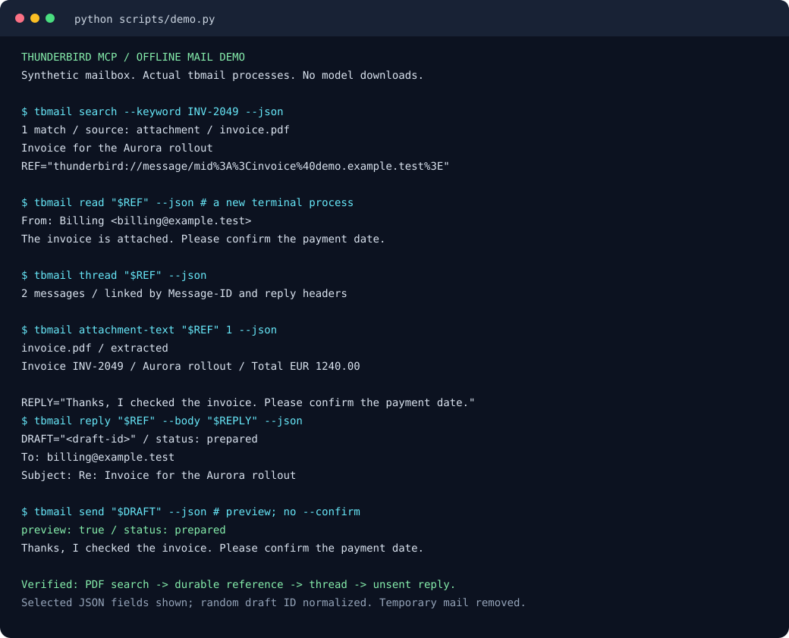

# Try the mail workflow without connecting an account

After installing the project dependencies with `uv sync --locked`, run:

```sh
uv run --locked --offline python scripts/demo.py
```

The demo generates three synthetic messages and a small PDF. Seven separate
`tbmail` processes build the index, find an invoice code that appears only in
the PDF, read the message using its durable URI, follow its reply thread,
extract the document text, prepare a reply, and inspect its unsent preview.
Each step checks the returned data; the command fails if the workflow breaks.

The demo uses a temporary home, Thunderbird profile, index, and outbox. It
does not read your account settings or credentials. Its Python processes
reject socket networking, use a disabled keyring backend, and keep semantic
search off. The temporary mailbox and draft are removed on exit. Installing
dependencies may require internet access; running the installed demo does not.

`tbmail send` without `--confirm` previews a draft. This demo never passes
`--confirm`, and rejects delivery or live-mail arguments. The demo does not
exercise an AI model or claim to show a recorded Codex/Claude conversation.
It exercises the mail operations those clients use.



The terminal preview selects fields from the actual JSON responses. It
normalizes the random draft ID and omits timestamps and temporary paths.
Regenerate it by running the workflow again:

```sh
uv run --locked --offline python scripts/demo.py --svg docs/demo.svg
```

For machine-readable results, add `--json`. The demo test checks that the
committed SVG still matches a fresh, verified run.
